<!-- ═════════════ LOCK SCREEN ═════════════ -->

  

<!-- ═════════════ DOCK (clickable) ═════════════ -->

  
  &nbsp;&nbsp;&nbsp;
  
  &nbsp;&nbsp;&nbsp;
  

  
  
  

 

<!-- ═════════════ CONTROL CENTER ═════════════ -->

  

 

<!-- ═════════════ NOTIFICATIONS ═════════════ -->

  

 

<!-- ═════════════ FOCUS MODES ═════════════ -->

  

 

<!-- ═════════════ SETTINGS (TECH STACK) ═════════════ -->

  

 

<!-- ═════════════ HOME SCREEN (PROJECTS) ═════════════ -->

  

<!-- ⚠️ Change these repo names to your real repos -->

  
  
  
  

 

<!-- ═════════════ SIRI SUGGESTIONS ═════════════ -->

  

 

<!-- ═════════════ LEARNING RINGS ═════════════ -->

  

 

<!-- ═════════════ ROADMAP ═════════════ -->

  

 

<!-- ═════════════ WALLET (CERTIFICATIONS) ═════════════ -->

  

 

<!-- ═════════════ ACTIVITY (auto-generated from your real contributions) ═════════════ -->

  

  

<!-- ═════════════ SNAKE (auto-generated by .github/workflows/profile.yml) ═════════════ -->

  <picture>
    <source media="(prefers-color-scheme: dark)" srcset="assets/github-snake-dark.svg" />
    <source media="(prefers-color-scheme: light)" srcset="assets/github-snake.svg" />
    
  </picture>

 

<!-- ═════════════ NOTES (QUOTE) ═════════════ -->

  

 

<!-- ═════════════ SHARE SHEET (CONTACT) ═════════════ -->

  

  
  
  

 

<!-- ═════════════ FOOTER ═════════════ -->

  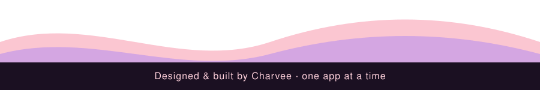

